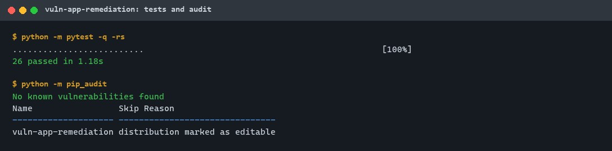
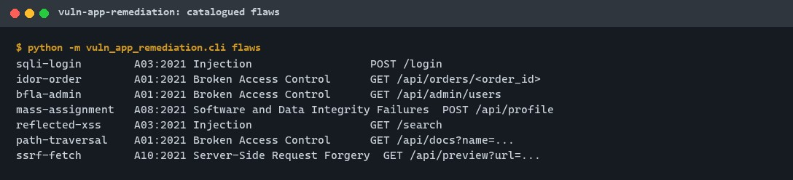
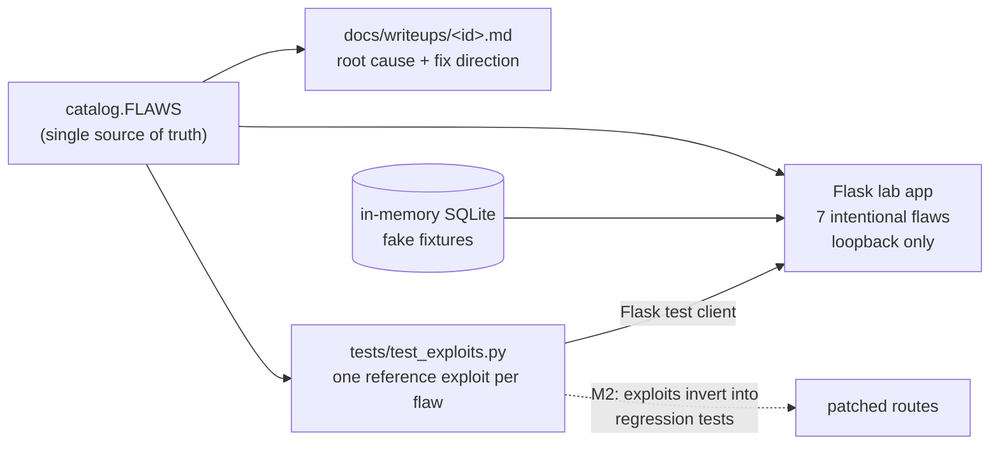
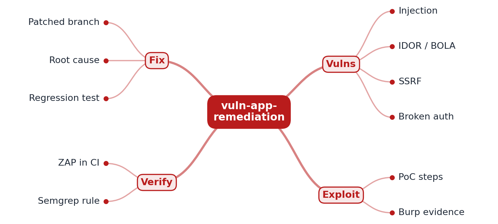

# vuln-app-remediation

[](https://github.com/EquinoxWN/vuln-app-remediation/actions/workflows/ci.yml)


> Learn to find and fix the vulnerabilities that cause real breaches: each one exploited in a local lab, explained, then patched.

Part of my **Cyber Security** list · Python · core project

> **Warning:** this app is intentionally vulnerable. It binds to `127.0.0.1`, refuses to start
> without `VULN_APP_I_UNDERSTAND=yes`, and must never be exposed to a network. All credentials in it
> are fake (`EXAMPLE-NOT-A-SECRET`).

## Proof it works

35 tests pass locally, including one reference exploit per catalogued flaw, and the dependency audit is clean:



The catalogue of 7 intentional flaws, each mapped to the OWASP Top 10 2021:



## Architecture

**What M1 runs today:**



**Full roadmap (M1 to M3):**



## How it works

_Steps 1 and 2 are built and tested (M1); the rest is on the [roadmap](#roadmap)._

1. An intentionally vulnerable Flask app carries 7 flaws mapped to the OWASP Top 10 2021 and, where it applies, the API Top 10 2023. It runs only on loopback; CI runs its tests in a container with no network.
2. Each flaw has a write-up (what goes wrong, root cause, fix direction) and a proof-of-concept expressed as an automated reference exploit.
3. M2 patches each flaw at its root cause, not just the symptom.
4. M2: each exploit test turns into a regression test proving the exploit no longer works.
5. M3: OWASP ZAP runs in CI against the vulnerable and patched code to show the difference.
6. M3: a Semgrep rule per bug class catches the same mistake in future code.

| Flaw | OWASP Top 10 2021 | API Top 10 2023 | Write-up |
|---|---|---|---|
| SQL injection in login | A03 Injection | - | [sqli-login](docs/writeups/sqli-login.md) |
| IDOR on order details | A01 Broken Access Control | API1 BOLA | [idor-order](docs/writeups/idor-order.md) |
| Admin route without role check | A01 Broken Access Control | API5 BFLA | [bfla-admin](docs/writeups/bfla-admin.md) |
| Mass assignment of `role` | A08 Software and Data Integrity Failures | API6 | [mass-assignment](docs/writeups/mass-assignment.md) |
| Reflected XSS in search | A03 Injection | - | [reflected-xss](docs/writeups/reflected-xss.md) |
| Path traversal in downloads | A01 Broken Access Control | - | [path-traversal](docs/writeups/path-traversal.md) |
| SSRF in link preview | A10 SSRF | API7 SSRF | [ssrf-fetch](docs/writeups/ssrf-fetch.md) |

## Who it helps

- **Who:** developers preparing for secure-code-review interviews, and anyone learning the OWASP Top 10 who wants a running target instead of slides.
- **The problem:** bug classes are easy to name and hard to recognise in a real handler; there is rarely a small, safe target where a flaw is shown, explained and later proven fixed.
- **How to use it:** read a flaw's handler in `app.py`, run its reference exploit with `pytest`, then read the write-up's root cause and fix direction. Each example is a few lines of code with a test that demonstrates it, all on your own machine.

## Tech stack

| Area | In M1 | Planned |
|---|---|---|
| App | Flask 3.1, SQLite (in memory), Python 3.11+ | Patched routes (M2) |
| Proof | pytest reference exploits, Flask test client | Regression tests (M2), OWASP ZAP before/after in CI (M3) |
| Static checks | ruff (incl. bandit rules), mypy `--strict`, pip-audit | Semgrep rule per bug class (M3) |
| Isolation | loopback bind, start-up refusal, CI container with `--network none` | - |

Language: **Python** (3.11+). Code in [`src/vuln_app_remediation/`](src/vuln_app_remediation): `catalog.py` (the flaws), `app.py` (the lab), `db.py` (fake fixtures), `cli.py`.

## Run it

**Prerequisites:** Python 3.11+. Docker is not needed locally; CI builds the image.

```bash
python -m venv .venv && source .venv/bin/activate   # Windows: .venv\Scripts\activate
pip install -e ".[dev]"
python -m ruff check . && python -m ruff format --check . && python -m mypy   # make lint
python -m pytest -q -rs                                                      # make test (35 tests)
python -m vuln_app_remediation.cli flaws                                     # make flaws
```

To browse the lab yourself, on your own machine only:

```bash
VULN_APP_I_UNDERSTAND=yes VULN_APP_PORT=5000 vuln-lab serve   # binds 127.0.0.1:5000
```

| Env var | Meaning | Default |
|---|---|---|
| `VULN_APP_I_UNDERSTAND` | must be `yes` or `serve` refuses to start (exit 2) | unset |
| `VULN_APP_PORT` | loopback port, integer 1024..65535 (otherwise exit 2) | `5000` |

## Tests and results

Full numbers and commands: [docs/results/m1.md](docs/results/m1.md). The 10-rule quality check (failure paths, mutation testing) is in [docs/quality/2026-11-01.md](docs/quality/2026-11-01.md).

| Test file | Tests | What it proves |
|---|---|---|
| `tests/test_exploits.py` | 8 | A reference exploit per flaw (7), each after a baseline check, plus a guard that every catalogued flaw has one |
| `tests/test_app_basics.py` | 8 | Banner, catalogue endpoint, and empty, invalid and anonymous requests get 4xx, never 500 |
| `tests/test_catalog.py` | 6 | Catalogue integrity, unknown-id error, backlog categories present, a write-up per flaw |
| `tests/test_cli.py` | 8 | JSON listing, start-up refusal, invalid ports rejected, unknown command |
| `tests/test_db.py` | 4 | Fixtures are fake and consistent |
| `tests/test_smoke.py` | 1 | Package version |

| Check | Result |
|---|---|
| Tests | **35 passed**, 0 failed (Windows 11, Python 3.14.5) |
| Exploits | 7 of 7 catalogued flaws demonstrated |
| Mutation testing | 8 of 8 hand mutants killed |
| Lint / types / audit | ruff and mypy `--strict` clean; `pip-audit`: no known vulnerabilities |
| CI only | Docker build and the in-container run (`--network none`, read-only, non-root) |

## Roadmap

**M1** (≈15 h)
- [x] Write `docs/rfc/0001-design.md`: problem, goals, non-goals, chosen design
- [x] An intentionally vulnerable app with flaws mapped to the OWASP Top 10 and API Top 10, local only (single `main` branch; container run in CI).
- [x] Each flaw has a write-up with a proof-of-concept (automated reference exploit instead of a Burp capture, see ADR 0002).

**M2** (≈20 h)
- [ ] Patch each flaw and explain the root cause, not just the symptom.
- [ ] A regression test proves each exploit no longer works.

**M3** (≈25 h)
- [ ] OWASP ZAP runs in CI against the vulnerable and patched code to show the difference.
- [ ] A Semgrep rule per bug class catches the same mistake in future code.
- [ ] Publish the proof below with real numbers

## Proof

What this repo must show before it counts as done:

- ZAP findings before vs after, with a linked write-up for each vulnerability.

| Result | Value |
|---|---|
| ZAP before vs after | Not measured yet (M3). Current M1 numbers: see [Tests and results](#tests-and-results). |
| Write-ups | 7 of 7 flaws, in [docs/writeups/](docs/writeups/) |

## Why it matters

- **Interview angle:** secure code review: "find and fix the vulnerability in this code".
- **Upstream I'd like to contribute to:** OWASP Juice Shop or ZAP.

## Design docs

- [RFC 0001: design](docs/rfc/0001-design.md)
- [ADR 0001: record architecture decisions](docs/adr/0001-record-architecture-decisions.md)
- [ADR 0002: proofs of concept as tests, not Burp captures](docs/adr/0002-exploits-as-tests-not-burp-captures.md)
- [ADR 0003: loopback-only binding and a start-up refusal](docs/adr/0003-loopback-only-and-startup-refusal.md)
- [M1 results](docs/results/m1.md)

## Scope

This is a learning and portfolio system, not a hosted production service. Everything runs locally, and the exploits target only the lab's own in-process app.

## Security and contributing

- The app is insecure on purpose; see [SECURITY.md](SECURITY.md) for what to report and how to run it safely.
- Every GitHub Action is pinned to a commit SHA and the base image to a digest; workflows run read-only, without persisted credentials.
- Dependabot update pull requests are paused (`open-pull-requests-limit: 0`) so the repository keeps a single `main` branch; CI runs `pip-audit` on every push.
- To contribute, see [CONTRIBUTING.md](CONTRIBUTING.md).

## License

MIT, see [LICENSE](LICENSE).
